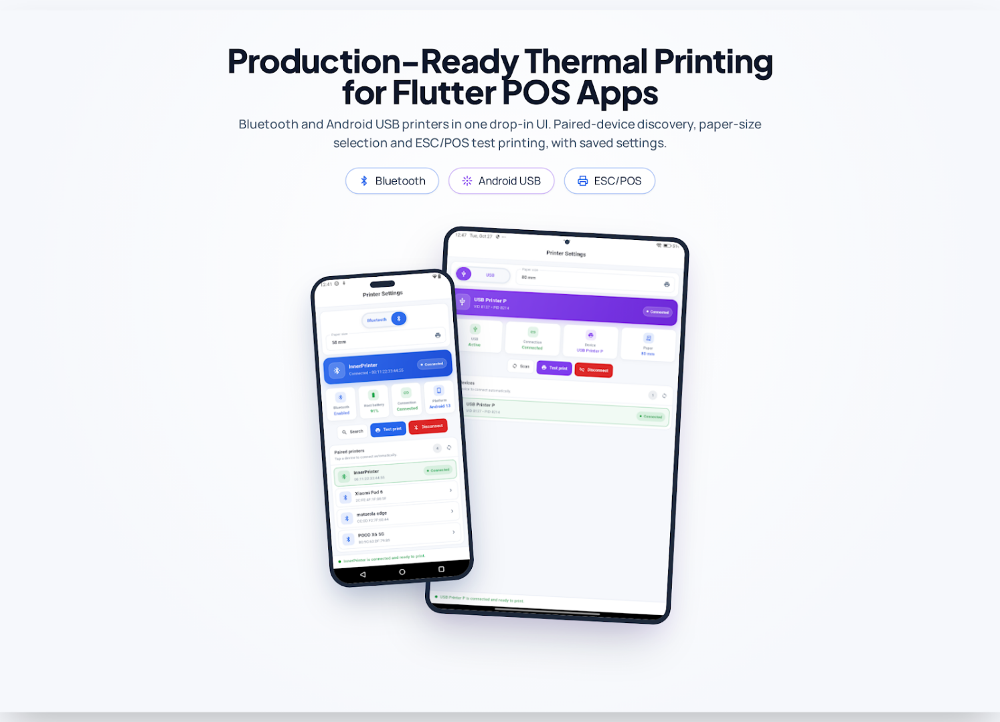

# posprinter_thermal

A premium, brandable **Bluetooth + USB thermal printer SDK** for Flutter.

It ships production-ready connection screens, handles paired-device discovery,
persists the selected printer with Hive, and prints ESC/POS test receipts —
without forcing a state-management package or an app-specific theme on the host
app.

| | |
|---|---|
| **Bluetooth** | Classic/paired printers via `print_bluetooth_thermal` (Android, iOS, Windows) |
| **USB** | USB host printers via `posprinter_usb_android` (**Android only**) |
| **Paper sizes** | 58 mm and 80 mm |
| **Persistence** | Hive (opened lazily by the SDK) |
| **Feedback** | Built-in overlay toasts + themed dialogs — no `ScaffoldMessenger`, no toast package |

The SDK is intentionally limited to Bluetooth and USB. Network/TCP printing is
not included.

USB host access only exists on Android. On every other platform the SDK never
touches the USB plugin: the connection-type toggle is hidden, the screen falls
back to Bluetooth, and the USB plugin's iOS/Windows code is not part of the
package you install.

## Platform support

**Primary use case: Android POS terminals and kiosks.** This SDK is built for
Android point-of-sale machines that print over **USB** (fixed, always-connected
cash-register printers) or **Bluetooth** (portable 58 mm / 80 mm roll
printers), and for kiosk builds that need a wired USB printer to survive being
left unattended. iOS is supported for Bluetooth-only companion apps — USB host
access is an Android capability, so a POS or kiosk device is the natural home
for this package.

| Platform | Bluetooth | USB | Notes |
|---|---|---|---|
| **Android** | ✅ | ✅ | Both transports. Bluetooth uses runtime `BLUETOOTH_SCAN` / `BLUETOOTH_CONNECT` permissions on Android 12+; USB uses the Android USB host API. |
| **iOS** | ✅ | ❌ | **Bluetooth only — USB is Android-only.** The toggle is hidden, so the settings screen opens straight on Bluetooth. iOS prompts for Bluetooth from `NSBluetoothAlwaysUsageDescription`; no `permission_handler` call is made. |
| Windows | ✅ | ❌ | Pair the printer in Windows settings first. |
| macOS / Linux / Web | ⚠️ | ❌ | Best effort — validate on your target platform before shipping. |

**TL;DR:** Android gets Bluetooth + USB, iOS gets Bluetooth only.

---

## Quick start

```yaml
dependencies:
  posprinter_thermal:
    path: ../posprinter_thermal # or the pub.dev version
```

```dart
import 'package:flutter/material.dart';
import 'package:posprinter_thermal/pos_printer_sdk.dart';

Future<void> main() async {
  WidgetsFlutterBinding.ensureInitialized();

  await PrinterSdk.initialize(
    // Your brand color, used everywhere in the SDK UI.
    primaryColor: const Color(0xFF0F766E),
    hiveBoxName: 'my_app_printer',
    appBarTitle: 'Printer Settings',
  );

  runApp(const MyApp());
}

class MyApp extends StatelessWidget {
  const MyApp({super.key});

  @override
  Widget build(BuildContext context) {
    return MaterialApp(
      theme: ThemeData(
        useMaterial3: true,
        colorScheme: ColorScheme.fromSeed(
          seedColor: PrinterSdkConfig.primaryColor,
        ),
      ),
      home: const CommonPrinterSettingScreen(),
    );
  }
}
```

`PrinterSdk.initialize` is optional: every screen initializes the SDK lazily.
Calling it once avoids a brief delay on first open and lets you set branding in
one place.

---

## How to open the settings

The settings screen is a normal route — push it from anywhere: a gear icon, a
menu entry, or automatically on first launch.

```dart
// For example, in your app bar:
IconButton(
  icon: const Icon(Icons.print),
  tooltip: 'Printer settings',
  onPressed: () => Navigator.of(context).push(
    MaterialPageRoute<void>(
      builder: (_) => const CommonPrinterSettingScreen(),
    ),
  ),
);
```

What the user does once it is open:

1. **Pick the connection type** — Bluetooth or USB. The toggle only appears on
   Android; on iOS the screen opens straight on Bluetooth.
2. **Find the printer** — `Search` lists paired Bluetooth printers, `Scan` lists
   USB printers (Android).
3. **Tap the device to connect.** The choice is persisted, and the printer is
   reconnected automatically after an outage.
4. **`Test print`** prints the built-in ESC/POS test receipt, so the user knows
   the link works before using it for real jobs.

Prefer to embed instead? The inner screens are public too:

```dart
const BluetoothPrinterSettings();   // Bluetooth, no Scaffold (iOS/Android)
const PrinterSettingScreen();       // USB, no Scaffold (Android only)
const USBPrinterSettingsPage();     // USB with its own AppBar (Android only)
```

---

## The screen

`CommonPrinterSettingScreen` is the main entry point. It contains:

- a Bluetooth / USB toggle,
- a 58 mm / 80 mm paper selector (persisted),
- the Bluetooth connection screen (hero status, paired printers, reconnect
  banner, auto-reconnect, test print),
- the USB connection screen (hero status, scan, tap-to-connect device list,
  Disconnect while connected, auto-reconnect, test print),
- a live connection footer.

It is a normal `Scaffold`, so push it with any navigator (see
[How to open the settings](#how-to-open-the-settings)):

```dart
Navigator.of(context).push(
  MaterialPageRoute<void>(
    builder: (_) => const CommonPrinterSettingScreen(),
  ),
);
```

The individual screens are public too:

```dart
const BluetoothPrinterSettings();            // embeddable, no Scaffold
const PrinterSettingScreen();                // USB, embeddable, no Scaffold
const USBPrinterSettingsPage();              // USB with its own AppBar
```

All of them read `PrinterSdkConfig` at build time, so changing the brand color
takes effect immediately on the next build.

---

## Branding and configuration

All options live in `PrinterSdkConfig` (see
`lib/common_printer_service/printer_sdk_config.dart`) and can be set directly or
through `PrinterSdk.initialize(...)`:

```dart
PrinterSdkConfig.primaryColor = const Color(0xFF0F766E);
PrinterSdkConfig.primaryDarkColor = const Color(0xFF115E59);
PrinterSdkConfig.accentColor = const Color(0xFF14B8A6);
PrinterSdkConfig.successColor = const Color(0xFF16A34A);
PrinterSdkConfig.errorColor = const Color(0xFFDC2626);
PrinterSdkConfig.surfaceColor = Colors.white;
PrinterSdkConfig.backgroundColor = const Color(0xFFF6F8FC);
PrinterSdkConfig.borderRadius = 18;
PrinterSdkConfig.appBarTitle = 'Printers';
PrinterSdkConfig.showToasts = true;
PrinterSdkConfig.showPrintLoader = true;
PrinterSdkConfig.scanTimeout = const Duration(seconds: 6);
```

### Connection-type accents

Bluetooth and USB each have their own accent, so the two connection types stay
visually distinct in the toggle, the hero card, the action buttons and the
device list:

```dart
PrinterSdkConfig.bluetoothColor = const Color(0xFF2563EB); // blue
PrinterSdkConfig.bluetoothDarkColor = const Color(0xFF1D4ED8);
PrinterSdkConfig.usbColor = const Color(0xFF7C3AED); // violet
PrinterSdkConfig.usbDarkColor = const Color(0xFF6D28D9);
```

Both ship with platform-neutral Material defaults, so an app that sets nothing
still gets a coherent light theme on Android and iOS. `primaryColor` stays the
app-wide brand color (app bar, dialogs, loaders, generic accents); the two
connection accents only tint the transport-specific surfaces. Pass them through
`PrinterSdk.initialize(bluetoothColor: ..., usbColor: ...)` or assign them
directly.

While `showPrintLoader` is on, a floating bubble shows the bundled printing
animation next to `loadingLabel` (default `Printing`) while the job is sent to
the printer. The animation (`assets/animations/printer_loading.json`) ships
with the package, so host apps do not have to declare any asset.

Other useful fields: `hiveBoxName`, `paperSizes`, `defaultPaperSize`,
`connectTimeout`, `printTimeout`, `loadingLabel`, `screenPadding`,
`sectionSpacing`, `autoReconnect`, `reconnectDelays`,
`reconnectMaxAttempts`, `bluetoothHealthCheckInterval`.

`bluetoothHealthCheckInterval` controls the Bluetooth watchdog (default 15 s).
The underlying plugin has no connection stream and verifies a link by writing a
single space to the socket, so the interval is deliberately conservative. Set it
to `Duration.zero` to disable the watchdog; link failures are still detected on
print jobs and when the app returns to the foreground.

### Persistence

The SDK opens the Hive box named by `PrinterSdkConfig.hiveBoxName` on demand and
uses these keys (legacy names are preserved so existing installs keep working):

| Key | Meaning |
|---|---|
| `macid` | Saved Bluetooth MAC |
| `device_name` | Saved Bluetooth printer name |
| `vendorId` / `productId` / `printerName` | Saved USB printer |
| `printer_paper_size` | `58 mm` / `80 mm` |
| `printer_connection_type` | Last selected connection type |

If your app already calls `Hive.initFlutter()` (or `Hive.init(path)`), the SDK
reuses it. If Hive is unavailable the SDK degrades gracefully to in-memory
settings instead of crashing.

---

## Platform setup

### Android

`android/app/src/main/AndroidManifest.xml`:

```xml
<uses-permission android:name="android.permission.BLUETOOTH" android:maxSdkVersion="30" />
<uses-permission android:name="android.permission.BLUETOOTH_ADMIN" android:maxSdkVersion="30" />
<uses-permission android:name="android.permission.BLUETOOTH_SCAN"
    android:usesPermissionFlags="neverForLocation" />
<uses-permission android:name="android.permission.BLUETOOTH_CONNECT" />
<uses-feature android:name="android.hardware.usb.host" android:required="false" />
```

The Bluetooth permissions are requested at runtime by the screen. USB access is
requested by the platform when the printer is opened. A `minSdk` of 21 or newer
is required.

The USB plugin declares `android.hardware.usb.host` itself and asks for no
permissions of its own, so it does not merge any Bluetooth or location
permission into your app.

### iOS

Add the Bluetooth usage description to `ios/Runner/Info.plist`:

```xml
<key>NSBluetoothAlwaysUsageDescription</key>
<string>This app uses Bluetooth to connect to your thermal printer.</string>
<key>NSBluetoothPeripheralUsageDescription</key>
<string>This app uses Bluetooth to connect to your thermal printer.</string>
```

That is all the setup iOS needs. The SDK deliberately does **not** call
`permission_handler` there: `Permission.bluetoothScan` and
`Permission.bluetoothConnect` are Android 12+ runtime permissions, and
`permission_handler_apple` does not implement them — it reports them
permanently denied, which would block the search button. iOS shows its own
CoreBluetooth prompt the first time the printer plugin scans or connects, driven
by the keys above. `BluetoothService.requiresRuntimePermissions` is `false`
there.

If your **own** code uses `Permission.bluetooth` on iOS, enable the Bluetooth
macro in your `Podfile` and run `pod install`:

```ruby
post_install do |installer|
  installer.pods_project.targets.each do |target|
    flutter_additional_ios_build_settings(target)
    target.build_configurations.each do |config|
      config.build_settings['GCC_PREPROCESSOR_DEFINITIONS'] ||= [
        '$(inherited)',
        'PERMISSION_BLUETOOTH=1',
      ]
    end
  end
end
```

USB printing is not available on iOS: the SDK hides the Bluetooth/USB toggle and
offers Bluetooth only, and the USB plugin's iOS code is not installed or built
at all.

### Windows

Bluetooth uses the Windows implementation of `print_bluetooth_thermal`. Pair the
printer in Windows settings first. USB is Android-only.

### macOS / Linux / Web

USB is unsupported: the toggle is hidden and the SDK shows the Bluetooth screen.
Bluetooth support depends on the underlying printer packages; validate on your
target platform before shipping.

---

## Programmatic API

```dart
// Bluetooth
await BluetoothService.init(); // restores the saved printer
final devices = await BluetoothService.getBluetoothDevices();
await BluetoothService.connectToBluetoothPrinter(
  mac: devices.first.macAdress,
  deviceName: devices.first.name,
);
final ok = await BluetoothService.printBytes(
  bytesToPrint: await BluetoothService.demoPrintBluetooth(
    printerName: devices.first.macAdress,
  ),
);
await BluetoothService.reconnectSaved();

// USB
if (PrinterService.isSupported) {
  await PrinterService.init();
  await PrinterService.scan();
  final printers = PrinterService.availablePrinters;
  if (printers.isNotEmpty) {
    await PrinterService.connect(printers.first);
    await PrinterService.testPrint();
    await PrinterService.disconnect();
  }
}
```

Both services expose status streams (`PrinterService.statusStream`,
`BluetoothService.statusStream`), lifecycle events (`connectionEvents`) and
boolean getters (`isScanning`, `isPrinting`, `isReconnecting`, ...).

### Automatic reconnect

`PrinterSdk.initialize` starts both connection services once per process:

- `PrinterService` listens to the native USB state stream, so a cable pull is
  noticed even when the settings screen is closed.
- `BluetoothService` restores the persisted printer, verifies whether the native
  socket survived a Flutter hot restart, and starts a reconnect loop when it did
  not. A watchdog notices a printer that is switched off while the app is idle.

The saved printer is reconnected with a configurable backoff. Host apps can
listen to either service's events without owning the reconnect logic:

```dart
// Optional: configure the backoff once at startup.
await PrinterSdk.initialize(
  autoReconnect: true,
  reconnectDelays: const <Duration>[
    Duration(seconds: 2),
    Duration(seconds: 4),
    Duration(seconds: 10),
    Duration(seconds: 30),
  ],
  reconnectMaxAttempts: 0, // 0 = keep trying (kiosk-friendly)
  bluetoothHealthCheckInterval: const Duration(seconds: 15),
);

// Host UI can react to the lifecycle without owning the reconnect logic.
PrinterService.connectionEvents.listen((event) {
  switch (event.type) {
    case PrinterConnectionEventType.disconnected:
    case PrinterConnectionEventType.reconnecting:
      // Show a non-blocking banner.
      break;
    case PrinterConnectionEventType.reconnected:
      // Hide it.
      break;
    case PrinterConnectionEventType.reconnectFailed:
      // Offer a manual "Reconnect" action.
      break;
  }
});
```

A manual `disconnect()` on either service stops the loop and (by default)
forgets the saved printer. Passing `clearSaved: false` keeps the record for
later, which is what the connection-type toggle uses. Scanning no longer
disconnects an active printer, and `printBytes()` retries a failed job once
after reconnecting. Use `BluetoothService.reconnectSaved()` /
`PrinterService.reconnectSaved()` for an explicit retry button.

### Custom UI

The design system is exported as widgets, so you can build your own screens with
the same look:

`PrinterHeroCard`, `PrinterStatusGrid`, `PrinterStatusCard`,
`PrinterStatusPill`, `PrinterDeviceTile`, `PrinterEmptyState`,
`PrinterActionButton`, `showPrinterToast`, `showPrinterConfirmDialog`.

`showPrinterToast` renders into the host app's root overlay, so it works from
services and callbacks without a `ScaffoldMessenger` and without adding a toast
package to your `pubspec.yaml`. The SDK screens register that overlay through
`PrinterOverlay.attach(context)`; call it yourself if you build custom screens
and want toasts to work before an SDK screen has been opened:

```dart
PrinterOverlay.attach(context);
showPrinterToast('Printer connected.', type: PrinterToastType.success);
```

---

## Example

The repository doubles as a runnable demo:

```bash
flutter pub get
flutter run
```

A minimal pub.dev example lives in [`example/lib/main.dart`](example/lib/main.dart).
It shows the recommended `PrinterSdk.initialize(...)` call and how to push the
connection screen. Run it inside a host Flutter project (add
`android/`/`ios/` shells with `flutter create .`) or copy the file into your app.

The companion plugin lives in
[`patches/posprinter_usb_android`](patches/posprinter_usb_android) and is
released as its own package.

---

## Repository layout

| Path | What it is |
|---|---|
| `lib/` | The SDK that is published as `posprinter_thermal`. |
| `lib/main.dart` | Runnable demo host app. |
| `patches/posprinter_usb_android/` | The Android USB plugin, published separately as `posprinter_usb_android`. |
| `example/` | Minimal pub.dev example. |
| `android/`, `ios/`, ... | Host shells for the demo app. Excluded from the published archive. |

`pubspec_overrides.yaml` points this repository at the in-repo plugin checkout.
It is intentionally **not** part of the published package: consumers resolve
`posprinter_usb_android` from pub.dev instead.

---


## Troubleshooting

- **No Bluetooth devices listed** — pair the printer in the system settings
  first. The plugin lists *paired* devices.
- **Android 12+ cannot scan** — make sure `BLUETOOTH_SCAN` and
  `BLUETOOTH_CONNECT` are declared and granted. These runtime permissions are
  Android-only; the SDK does not request them on iOS.
- **USB printer not found** — confirm `android.hardware.usb.host`, use a data
  cable (not charge-only), and accept the Android USB permission prompt.
- **Toast not visible** — check `PrinterSdkConfig.showToasts`, and make sure an
  SDK screen has been built (or call `PrinterOverlay.attach(context)`) so the
  SDK knows the host app's overlay. Before that, messages are only printed to
  the debug console.
- **No USB option in the settings screen** — USB is Android-only, so the
  Bluetooth/USB toggle is hidden on iOS, macOS, Linux and web by design.
- **iOS shows no Bluetooth printers** — iOS has no "paired devices" concept for
  BLE: the plugin returns the peripherals the system already knows about. Make
  sure the printer is powered on and was paired/used before (Settings →
  Bluetooth), then tap `Search` again.
- **Settings not persisted** — make sure `PrinterSdk.initialize()` runs after
  `WidgetsFlutterBinding.ensureInitialized()`, or let the screens open Hive
  themselves.

---

## License and third-party components

## Screenshots



*Promotional mockup showing the printer settings UI on smartphone and tablet mockups.*

---

`posprinter_thermal` is released under the MIT license — see [LICENSE](LICENSE),
© 2026 Eishal Cyril and the posprinter_thermal contributors.
Your `LICENSE` stays yours: the packages this SDK depends on keep their own
licenses, and none of their license texts is merged into this file.

| Component | License | Notes |
|---|---|---|
| `posprinter_usb_android` | MIT | Maintained here, published separately. A fork of `flutter_pos_printer_platform_image_3` (MIT, © 2022 Gustavo Morales); the upstream copyright notice is retained in that package's `LICENSE`. |
| `print_bluetooth_thermal` | BSD-3-Clause | Used as a dependency only. BSD-3 asks for the copyright notice to be kept when the package itself is redistributed, not when something merely depends on it — so nothing needs to be appended here. |
| `flutter_esc_pos_utils`, `permission_handler`, `hive`, `hive_flutter`, `animated_toggle_switch` | MIT / BSD / Apache-2.0 | Runtime dependencies; see <https://pub.dev>. |

If you redistribute a **built binary** of an app that uses these packages, keep
their notices in your app's licence screen. Flutter generates an initial list
from the pub packages in your app's `pubspec.yaml`.
